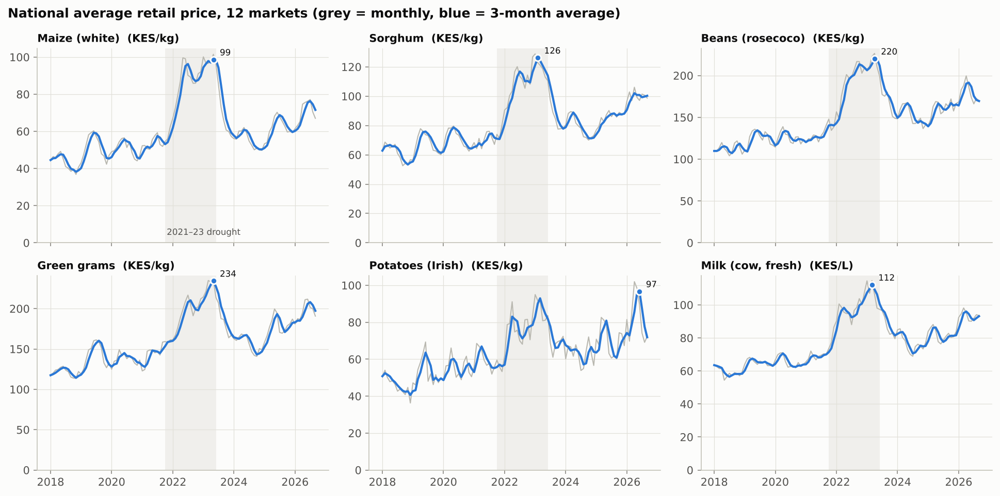
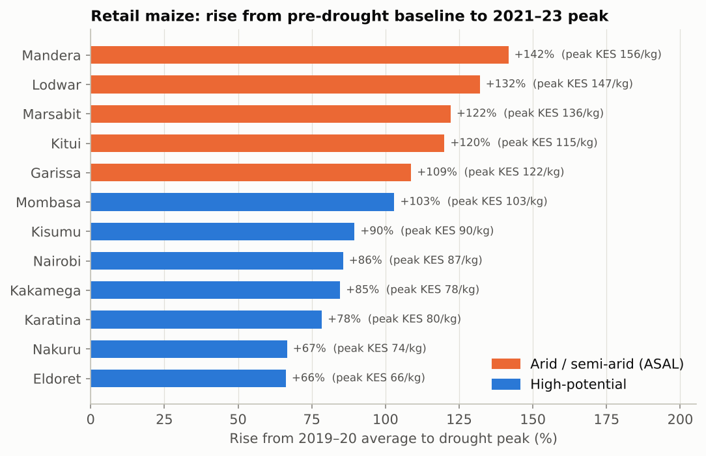
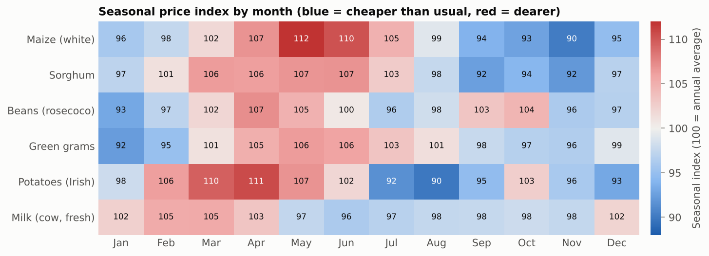

# Kenyan Food Market Prices: Drought, Seasonality and Regional Gaps (2018–2026)

An end-to-end data analytics project on monthly food prices in 12 Kenyan markets. It covers Python data cleaning, a SQLite star schema, SQL analysis with window functions, exploratory analysis in Jupyter, a SARIMA forecast, an interactive dashboard and a written findings report.

> **Data note:** the dataset in this repo is **simulated**. It follows the exact schema of the WFP [Kenya – Food Prices](https://data.humdata.org/dataset/wfp-food-prices-for-kenya) dataset on HDX. Its patterns (lean season, the 2021–23 drought, the 2023 shilling depreciation, higher prices in arid counties) are modelled on real market behaviour, but the prices are not real observations. The pipeline runs unchanged on the real HDX file (see [Using the real data](#using-the-real-data)).



## Business questions

1. How hard did the 2021–23 drought hit staple prices, and which markets suffered most?
2. When in the year are prices seasonally high or low?
3. How much more do households in arid and semi-arid (ASAL) counties pay?
4. Which foods are most volatile, and how much of the price movement is a currency effect?
5. Where are maize prices heading over the next 12 months?

## Key findings

| # | Finding | Evidence |
|---|---------|----------|
| 1 | **Drought dominates.** National average maize nearly doubled (+93%), from KES 51/kg in 2019–20 to a 3-month peak of KES 99/kg in 2023. | `q02`, notebook §2 |
| 2 | **The arid north was hit hardest.** Maize rose 125% in ASAL markets against 82% in high-potential markets. Mandera rose most (+142%). | `q03` |
| 3 | **Location costs money every year.** ASAL markets usually pay 25–40% more in normal years (potatoes up to 48%) and 45–65% in drought years. | `q05` |
| 4 | **Seasonality is predictable.** Maize is about 25% dearer in May than in November. | `q04` |
| 5 | **Potatoes are the most volatile staple** (14.7% monthly s.d., about double maize). Milk is the most stable (5.1%). | `q06` |
| 6 | **Currency matters.** In 2023 maize stayed near its peak in KES (index 162) but fell to 119 in USD terms. | `q09` |
| 7 | **Retailers passed costs through.** The retail mark-up over wholesale stayed close to 25% through the drought. | `q07` |
| 8 | **Forecast.** SARIMA (3.0% MAPE on a 12-month backtest, vs 4.0% for seasonal naive) expects Nairobi maize to ease to about KES 60/kg over the harvest, then rise to about KES 74/kg by May 2027. | notebook §8 |

<p float="left">
  
  
</p>

## Project structure

```
kenya-food-prices-analysis/
├── data/
│   ├── raw/wfp_food_prices_ken_synthetic.csv   # raw file in WFP/HDX schema (with injected quality issues)
│   ├── processed/prices_clean.csv              # cleaned panel
│   └── kenya_food_prices.db                    # SQLite star schema
├── src/
│   ├── generate_data.py                        # simulates the raw dataset
│   ├── clean.py                                # cleaning pipeline (works on the real HDX file too)
│   ├── load_db.py                              # builds the database and runs all SQL queries
│   └── export_dashboard_data.py                # JSON extracts for the dashboard
├── sql/
│   ├── schema.sql                              # fact + dimension tables, view
│   └── analysis_queries.sql                    # 10 analysis queries
├── notebooks/
│   └── kenya_food_prices_analysis.ipynb        # EDA, charts, forecast (executed, with outputs)
├── reports/
│   ├── figures/                                # 7 charts used in the report
│   ├── sql_results/                            # each SQL query's output as CSV
│   ├── cleaning_log.md
│   └── forecast_maize_nairobi.csv
├── requirements.txt
└── run_all.sh
```

## Pipeline

**1. Data quality and cleaning** (`src/clean.py`). The raw file contains realistic problems, and each is handled explicitly and logged:

| Issue | Fix |
|---|---|
| Inconsistent labels (`maize - white`, `Green Grams`, `NAIROBI `) | Normalised to 6 canonical commodities and 12 markets |
| 60 exact duplicate rows | Dropped |
| Zero prices | Dropped |
| Wholesale maize in 90 KG bags | Converted to price per kg |
| Decimal-slip typos (price ×10) | Detected with a robust z-score against a rolling median, then repaired |
| Missing months (~4%, more in remote markets) | Left missing; averages use reporting markets only |

**2. SQL** (`sql/`). A star schema (`fact_price`, `dim_market`, `dim_commodity`, `dim_fx`) plus a `v_price` view. The 10 queries show:

- `LAG(...) OVER (PARTITION BY ... ORDER BY month)` for year-on-year change
- rolling averages with `ROWS BETWEEN 2 PRECEDING AND CURRENT ROW`
- `RANK()` / `DENSE_RANK()` for market rankings
- seasonal index from a partitioned `AVG() OVER`
- self-joins (retail vs wholesale margin, latest vs year-ago snapshot)
- Pearson correlation computed in pure SQL (market integration with Nairobi)

Example: drought impact by market.

```sql
WITH base AS (
    SELECT market, zone, AVG(price_kes) AS baseline
    FROM v_price
    WHERE commodity = 'Maize (white)' AND price_type = 'Retail' AND year IN (2019, 2020)
    GROUP BY market, zone
),
peak AS (
    SELECT market, MAX(price_kes) AS peak_price
    FROM v_price
    WHERE commodity = 'Maize (white)' AND price_type = 'Retail'
      AND month BETWEEN '2021-10-01' AND '2023-12-01'
    GROUP BY market
)
SELECT b.market, b.zone,
       ROUND(100.0 * (p.peak_price / b.baseline - 1), 1) AS increase_pct,
       RANK() OVER (ORDER BY p.peak_price / b.baseline DESC) AS rank_hardest_hit
FROM base b JOIN peak p USING (market);
```

**3. Analysis and forecasting** (`notebooks/`). The notebook queries SQLite directly, draws the figures and fits a SARIMA(1,1,1)(0,1,1)12 model on log prices. The model is checked with a 12-month hold-out backtest against a seasonal-naive baseline.

**4. Communication.** An interactive dashboard (commodity filter, KPI tiles, trend, drought impact, seasonality heatmap, forecast and market table) and a written findings report with recommendations.

## How to run

```bash
pip install -r requirements.txt
bash run_all.sh
```

Or step by step:

```bash
python src/generate_data.py      # 1. raw data
python src/clean.py              # 2. clean
python src/load_db.py            # 3. SQLite + SQL queries -> reports/sql_results/
jupyter nbconvert --to notebook --execute --inplace notebooks/kenya_food_prices_analysis.ipynb
python src/export_dashboard_data.py
```

## Using the real data

1. Download `wfp_food_prices_ken.csv` from [HDX](https://data.humdata.org/dataset/wfp-food-prices-for-kenya).
2. Run `python src/clean.py path/to/wfp_food_prices_ken.csv`. The cleaner drops HDX's HXL tag row and converts bulk units.
3. Update the commodity names in `CANONICAL_COMMODITIES` (`src/clean.py`), and the market list in `ASAL_COUNTIES` (`src/load_db.py`) if needed.
4. Run `src/load_db.py` and the notebook as above.

## Limitations

- Simulated data: the results show the method, not real market conditions.
- National averages are unweighted means of reporting markets.
- The forecast is univariate. Rainfall or NDVI regressors would be needed to anticipate droughts.
- Prices are nominal. Deflating by CPI would separate real changes from general inflation.

## Skills demonstrated

Python (pandas, NumPy) · data cleaning and validation · SQL (SQLite, CTEs, window functions, star schema) · exploratory data analysis · time-series analysis and forecasting (statsmodels SARIMA, backtesting) · data visualisation (matplotlib) · dashboard design · analytical writing
